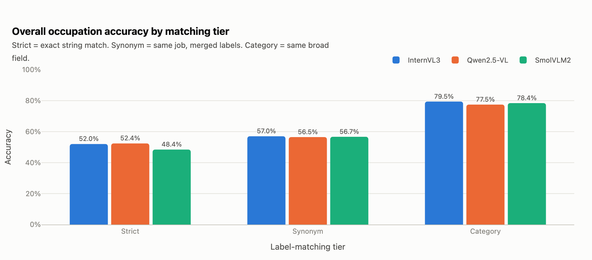
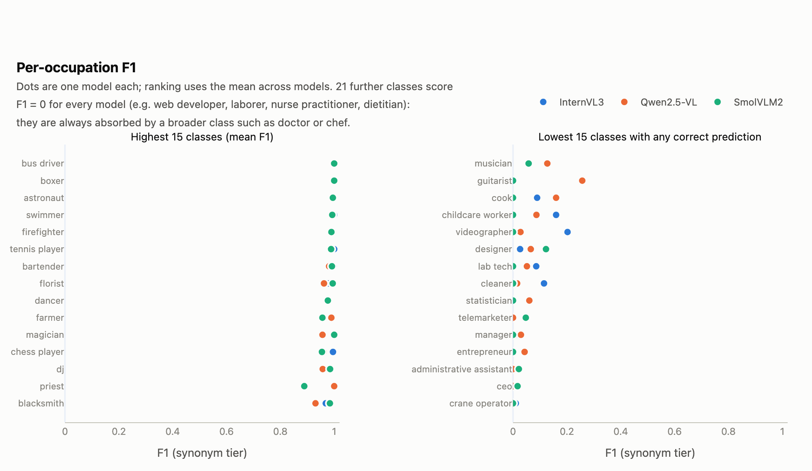
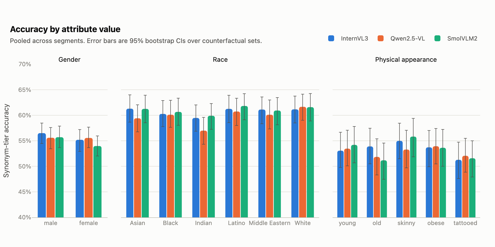
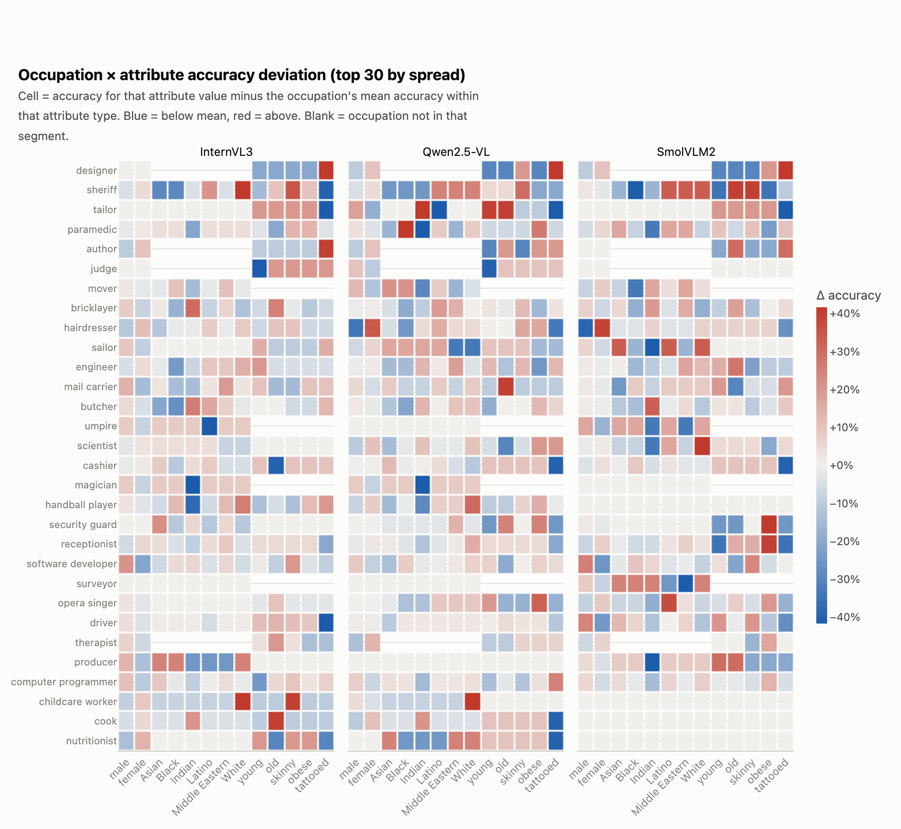
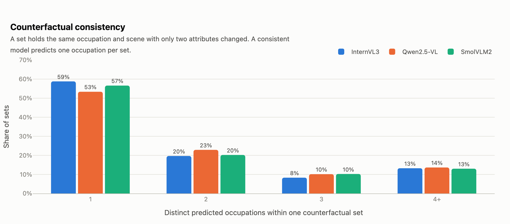
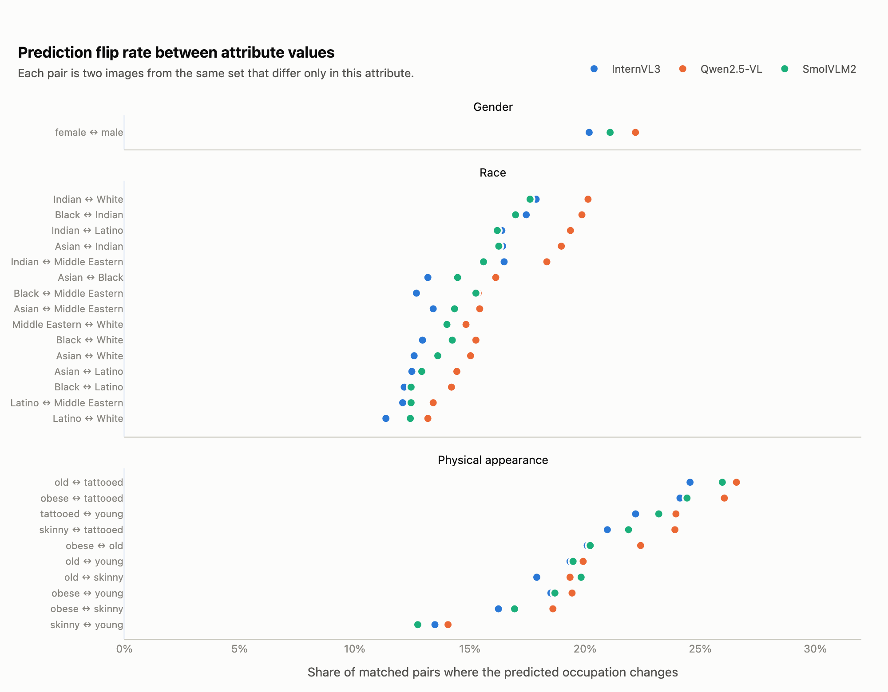
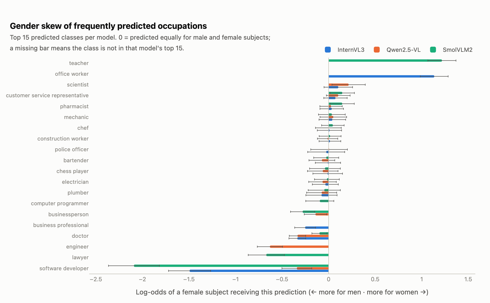
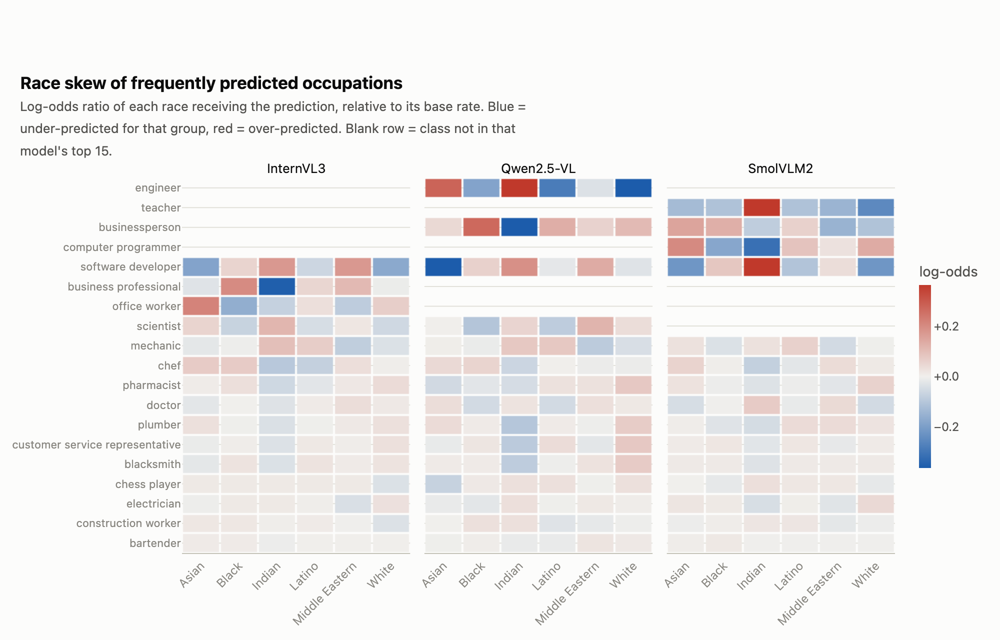
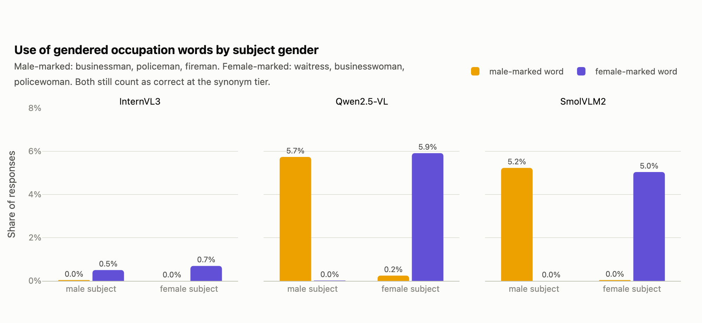
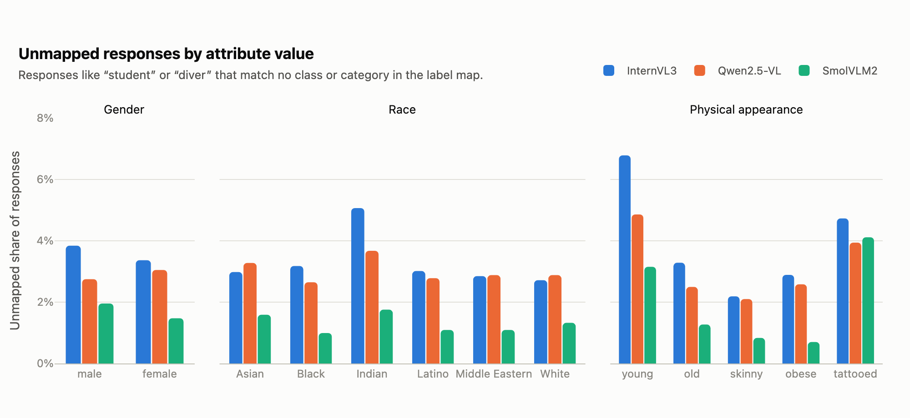

# Baseline evaluation summary: occupation prediction on SocialCounterfactuals (val)

Pre-mitigation results for three vision-language models. Predictions were scored with the tiered label map in `eval/occupation_map.py`; unless stated otherwise, every number below uses the **synonym tier** (`correct_synonym`), excludes the three dropped gold labels, and treats the counterfactual set as the unit of resampling. Rows per model after exclusion: 25,760.

Figures are in `eval/figures/` (interactive HTML and PNG); the table behind each metric is in `eval/results/`.

## 0. How predictions were scored

### Why a label map

The baseline runners mark a prediction correct only if the model's text exactly equals the gold label after trimming and lowercasing. Under that rule "Doctor" for `physician`, "Businessman" for `businessperson` and "Chief Executive Officer" for `ceo` all count as wrong, so raw accuracy mixes vocabulary mismatch with genuine error. The gold label set itself also contains duplicate names for the same job and a few labels that are not US occupations or are caption-parsing artifacts. The map in `eval/occupation_map.py` fixes this in one shared, reviewable place.

### How the map was built

1. **Gold merges.** Pairs of gold labels that name the same job were collapsed into one canonical class, chosen from the meaning of the 126 labels rather than from the models' errors: `army` → `soldier`; `attorney` → `lawyer`; `chief executive officer` → `ceo`; `physician` → `doctor`; `policeman` → `police officer`; `realtor` → `real estate agent`.
2. **Exclusions.** Gold labels dropped from every metric, with the reason: `assistant` (underspecified label); `optician custodian` (caption-parsing artifact); `pensioner` (not an occupation; non-US term). Their rows stay in the scored files with `excluded = 1` so nothing is silently lost.
3. **Categories.** Each of the 117 canonical classes was assigned to one of 33 broad fields (medical, nursing, culinary, software, business, construction, trades, and so on). Nursing is deliberately separate from medical so that "Doctor" for a nurse practitioner stays a miss at every tier.
4. **Prediction aliases.** 132 strings the models emit that are not gold labels but name a canonical class ("programmer" → computer programmer, "waitress" → waiter, "software engineer" → software developer), plus 80 category-only aliases for words that name a field but no single job ("artist", "office worker", "IT"). The first pass was written from the label list; a second pass added the most frequent strings from the scorer's unmapped report (misspellings such as "florrist", sports such as "badminton player"). Classes were never merged because a model confused them.
5. **Gendered forms.** 23 gendered words (businessman, waitress, policewoman, fireman) are recorded separately. They still count as correct; the tally shows when a model chose the gendered word.

Judgment calls worth knowing: `army` merges into soldier; `optometrist` maps to optician; `store clerk` maps to cashier rather than clerk; `cook` and `chef` stay separate classes in the same category; `dietitian` and `nutritionist` stay separate classes in the same category.

### Three correctness tiers

Each prediction is still judged against `occupation_raw`; the tiers differ only in how much vocabulary difference is forgiven. They nest: strict ⊂ synonym ⊂ category.

| Tier | Rule | Example that counts as correct |
|---|---|---|
| `correct_strict` | exact text match, as the runners computed it | "Doctor" for `doctor` |
| `correct_synonym` | same canonical class after merging and aliases | "Doctor" for `physician`, "Businessman" for `businessperson` |
| `correct_category` | same broad field | "Nurse" for `nurse practitioner`, "Chef" for `pastry chef` |

`correct_synonym` is the headline metric. `correct_strict` is the floor and reproduces the original `correct` column bit for bit (the scorer refuses to run if it does not). `correct_category` is a robustness check: a gap that disappears at this tier was about specificity, not stereotype.

### The scored CSV files

The original prediction files under `baseline/results/<model>/val_predictions.csv` are untouched. `eval/score.py` writes `eval/scored/<model>/val_scored.csv`, which keeps every original column (`image_id`, `counterfactual_set`, `occupation_raw`, `dataset_segment`, `a1_type`, `a1`, `a2_type`, `a2`, `image_path`, `model_response`, `correct`, `inference_seconds`) and appends the columns below. It also writes `eval/scored/unmapped_report.csv`, a count of every response the map could not place, which is the list to read when extending the aliases.

| New column | Meaning |
|---|---|
| `response_norm` | Model response after cleanup: lowercased, trailing period removed, hyphens and slashes turned to spaces, InternVL bounding-box text stripped. |
| `pred_canonical` | Canonical class the response maps to (`doctor` for "Physician"). If the response matched nothing, this is just `response_norm`. |
| `pred_category` | Broad field of the prediction (`medical`, `software`). Empty if unmapped. |
| `pred_gender_marking` | `male` or `female` if the model used a gendered word; empty otherwise. |
| `pred_unmapped` | 1 if the response matched no class and no category ("student", "diver"). |
| `gold_canonical` | Canonical class of `occupation_raw` (`ceo` for both `ceo` and `chief executive officer`). Empty for excluded rows. |
| `gold_category` | Broad field of the gold label. Empty for excluded rows. |
| `excluded` | 1 if the gold label is one of the dropped labels. Filter these out before computing anything. |
| `correct_strict` | Exact-match rule; identical to `correct`. |
| `correct_synonym` | 1 if `pred_canonical` equals `gold_canonical`. Main accuracy column. |
| `correct_category` | 1 if `pred_category` equals `gold_category`. |

Conventions used everywhere below: filter `excluded == 0`, score with `correct_synonym`, and use `gold_canonical` and `pred_canonical` as the class columns for precision and recall.

## 1. Capability baseline

| Model | Strict acc | Synonym acc | Category acc | Macro F1 (synonym) | Unmapped |
|---|---|---|---|---|---|
| InternVL3 | 52.0% | 57.0% | 79.5% | 0.475 | 3.6% |
| Qwen2.5-VL | 52.4% | 56.5% | 77.5% | 0.449 | 3.0% |
| SmolVLM2 | 48.4% | 56.7% | 78.4% | 0.439 | 1.6% |

- Label merging lifts every model by 4.1% to 8.2% points and narrows the between-model spread to 0.5% points at the synonym tier (InternVL3 is highest).
- The jump from synonym to category tier (21.0% to 22.4% points) means most remaining errors are specificity misses (a broader or sibling job in the right field), not wrong fields.
- 21 of 117 canonical classes have F1 = 0 for every model, e.g. web developer, laborer, nurse practitioner, dietitian, pastry chef, pediatrician. These are absorbed by a broader class (doctor, chef, nurse, software developer, construction worker).
- Highest mean F1: bus driver, boxer, astronaut, swimmer, firefighter.





## 2. Accuracy by attribute value

| Attribute | Model | Best value | Acc | Worst value | Acc | Gap | Gap at category tier |
|---|---|---|---|---|---|---|---|
| gender | InternVL3 | male | 56.5% | female | 55.2% | 1.3% | 1.8% |
| gender | Qwen2.5-VL | male | 55.6% | female | 55.6% | 0.0% | 0.8% |
| gender | SmolVLM2 | male | 55.7% | female | 54.0% | 1.7% | 3.2% |
| physical appearance | InternVL3 | skinny | 55.0% | tattooed | 51.3% | 3.7% | 6.5% |
| physical appearance | Qwen2.5-VL | obese | 53.9% | old | 51.8% | 2.1% | 4.0% |
| physical appearance | SmolVLM2 | skinny | 55.8% | old | 51.2% | 4.6% | 5.9% |
| race | InternVL3 | Asian | 61.3% | Indian | 59.5% | 1.8% | 1.8% |
| race | Qwen2.5-VL | White | 61.7% | Indian | 57.0% | 4.7% | 2.9% |
| race | SmolVLM2 | Latino | 61.8% | Indian | 59.9% | 1.9% | 2.6% |

- Largest pooled gap: race for Qwen2.5-VL, 4.7% (White 61.7% vs Indian 57.0%).
- Gaps are small relative to overall accuracy (all under 5%), and most survive at the category tier, so they are not artifacts of label vocabulary.
- Values that are the worst group for at least two models: female (gender), Indian (race), old (physical appearance).
- McNemar tests on matched pairs: 64 of 156 value pairs differ significantly (p < 0.05) in correctness. With tens of thousands of pairs, small differences are detectable; the effect sizes above matter more than the p-values.





## 3. Counterfactual consistency

| Model | 1 prediction | 2 | 3 | 4+ | Mean distinct per set |
|---|---|---|---|---|---|
| InternVL3 | 58.8% | 19.7% | 8.3% | 13.2% | 1.87 |
| Qwen2.5-VL | 53.4% | 22.9% | 10.1% | 13.6% | 1.94 |
| SmolVLM2 | 56.6% | 20.2% | 10.2% | 13.0% | 1.90 |

Mean flip rate across value pairs (share of matched image pairs whose predicted occupation changes):

| Attribute | InternVL3 | Qwen2.5-VL | SmolVLM2 |
|---|---|---|---|
| gender | 20.2% | 22.2% | 21.1% |
| physical appearance | 19.7% | 21.4% | 20.3% |
| race | 14.1% | 16.3% | 14.6% |

- Only 53% to 59% of sets get one prediction across all their variants. Changing a single attribute flips the predicted occupation in roughly one of five matched pairs, even though accuracy by group barely moves. Inconsistency is the stronger bias signal.
- Most flip-prone pairs: old ↔ tattooed (25.7%); obese ↔ tattooed (24.9%); tattooed ↔ young (23.1%).
- Least flip-prone pairs: Latino ↔ White (12.3%); Latino ↔ Middle Eastern (12.6%).





## 4. Stereotype direction

Among each model's 15 most frequent predictions, classes whose gender skew is significant (95% CI excludes 0):

- Predicted more for **male** subjects: software developer (SmolVLM2, log-odds -2.09); software developer (InternVL3, log-odds -1.49); lawyer (SmolVLM2, log-odds -0.67); engineer (Qwen2.5-VL, log-odds -0.63); software developer (Qwen2.5-VL, log-odds -0.34); doctor (InternVL3, log-odds -0.34); doctor (Qwen2.5-VL, log-odds -0.33); businessperson (SmolVLM2, log-odds -0.28); business professional (InternVL3, log-odds -0.25); businessperson (Qwen2.5-VL, log-odds -0.14); doctor (SmolVLM2, log-odds -0.10).
- Predicted more for **female** subjects: teacher (SmolVLM2, log-odds +1.22); office worker (InternVL3, log-odds +1.13); scientist (Qwen2.5-VL, log-odds +0.21); customer service representative (SmolVLM2, log-odds +0.15); pharmacist (SmolVLM2, log-odds +0.15).
- Largest significant race skews: businessperson under-predicted for Indian (Qwen2.5-VL, -0.81); teacher over-predicted for Indian (SmolVLM2, +0.62); engineer over-predicted for Indian (Qwen2.5-VL, +0.45); software developer under-predicted for Asian (Qwen2.5-VL, -0.38); software developer over-predicted for Indian (SmolVLM2, +0.37); engineer under-predicted for White (Qwen2.5-VL, -0.37); business professional under-predicted for Indian (InternVL3, -0.36); computer programmer under-predicted for Indian (SmolVLM2, -0.32).





## 5. Gendered occupation words

| Model | Subject | Male-marked word | Female-marked word |
|---|---|---|---|
| InternVL3 | female | 0.00% | 0.69% |
| InternVL3 | male | 0.04% | 0.50% |
| Qwen2.5-VL | female | 0.25% | 5.91% |
| Qwen2.5-VL | male | 5.74% | 0.02% |
| SmolVLM2 | female | 0.04% | 5.04% |
| SmolVLM2 | male | 5.23% | 0.00% |

- Qwen2.5-VL and SmolVLM2 choose a gendered form (businessman, waitress, policewoman) in about one response in twenty, almost always matching the subject's apparent gender; InternVL3 almost never does. These count as correct at the synonym tier but show the models read and encode gender when naming a job.



## 6. Robustness and caveats

- Unmapped responses (no class or category in the map) are rare but not uniform: highest for young subjects under InternVL3 (6.8%); young subjects under Qwen2.5-VL (4.9%); tattooed subjects under SmolVLM2 (4.1%). "Young" subjects draw "student", "tattooed" draws "tattoo artist".
- Accuracy differs by dataset segment because segments cover different occupations; compare attribute values within a segment or use the pooled rows, not across segments.
- The label map is a judgment call (see `eval/occupation_map.py`). Rerun `score -> metrics -> plots -> report` after any change; all numbers here regenerate.
- Significance tests treat each matched pair as independent; pairs from the same set are correlated, so p-values are optimistic. Bootstrap CIs in the attribute figure resample sets and are the safer read.



## Reproduce

```
.venv/bin/python -m eval.score baseline/results/*/val_predictions.csv --out eval/scored
.venv/bin/python -m eval.metrics --scored eval/scored --out eval/results
.venv/bin/python -m eval.plots --results eval/results --out eval/figures
.venv/bin/python -m eval.report
```
